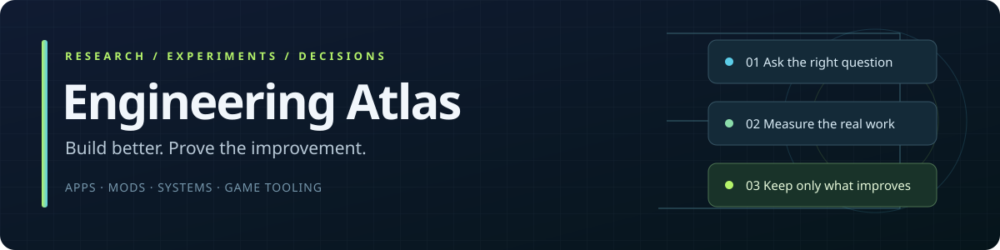

# Engineering Atlas

**Build better software. Prove the improvement. Keep the evidence.**

A practical, evolving research library for desktop apps, web services, Minecraft mods, game tooling and asset pipelines. Reviewed starting point: **October 26, 2026**. This is a curated foundation, not a claim that every technology has been exhaustively benchmarked.

## Ranked choices and measured experiments

[Best choices and avoid guidance](docs/ranked-recommendations.md) · [2026 paper and Codeberg-linked watchlist](docs/paper-watchlist-2026.md) · [Measured JSON lab](experiments/json-lab/README.md)

## Start here

[Experiment evidence directory](docs/experiment-evidence.md) organizes real-source tests, generated workloads, failures, repairs and remaining acceptance gates.

| Need | Guide |
|---|---|
| Choose a stack without hype | [Stack decision map](docs/stack-selection.md) |
| Reduce repeated algorithm/storage work | [Algorithms, storage and concurrency](docs/algorithms-storage-concurrency.md) |
| Make an application substantially faster | [Performance engineering](docs/performance.md) |
| Scan files, configs and archives safely and quickly | [File pipelines and worker tuning](docs/file-pipelines.md) |
| Index archives and detect changes correctly | [Archives and change tracking](docs/archive-and-change-tracking.md) |
| Build responsive desktop applications | [Desktop architecture](docs/desktop.md) |
| Build a web service and account integration | [Web and security](docs/web-security.md) |
| Build or extend a mod | [Mod development](docs/mods.md) |
| Build models, animation and game assets | [Game and asset pipelines](docs/game-assets.md) |
| Prove correctness and ship the tested build | [Testing and release](docs/testing-release.md) |
| Find the latest research and distinguish evidence | [Research method](docs/research-method.md) · [2026 review](research/2026-10-26.md) |

## The standard

A substantial improvement changes the actual end-to-end experience while retaining the required output and behavior. Caching, warm-up and perceived responsiveness can help, but they do not replace completing the work. Do not skip validation, hide warnings, lower fidelity or call stale results current to produce a better number.

“Best” is conditional on the workload, platform, security boundary, team and deployment constraints. A new version is a candidate, not a performance result. Keep stable production baselines and test experimental methods in isolated comparisons.

## Site adapters and real media

[Real public-media workbench](docs/media-lab/index.html) combines actual source snapshots, image-decode checks and explicit playback states. [Adapter laboratory](docs/adapters/README.md) tracks platform-specific access, reuse candidates, complete-media requirements and truthful evidence states. Paid/private fixtures stay private; source identity and playback are tested separately from metadata.

[Isolated parser experiment](experiments/adapter-parser-lab/README.md) retains full-output parity and a small-workload tail regression. It is not an accepted application upgrade.

## Browser card and storage experiments

[Card-density browser harness](docs/card-lab/index.html) tests initial rendering and keyed incremental updates with complete generated records. [Rust storage experiment](experiments/rust-storage-lab/README.md) retains transaction and durability boundaries. These are research workloads, not target-project acceptance.

## Executable R&D application

[Atlas Lab](apps/atlas-lab/README.md) is the early Rust experiment and collection core: real algorithm comparisons, a failure-preserving SQLite journal and a bounded public metadata adapter. It is not yet a finished autonomous app or universal collector.

## Reusable tools

- `python3 scripts/check_research.py`: validate the source register, internal links and evidence metadata without network access.
- `python3 -m unittest discover -s tests -v`: run the checking-tool tests.
- `python3 scripts/compare_benchmarks.py BASELINE.json CANDIDATE.json`: compare paired complete results; reject mismatched workloads, environments, conditions or output hashes.
- [Worker-sweep evaluator](docs/worker-sweep-tool.md): compare all five worker limits with explicit resource/UX budgets; no automatic default changes.
- [Experiment template](templates/experiment.md) · [Decision record](templates/decision.md) · [Benchmark format](docs/benchmark-format.md).

The fixture data is **synthetic test data**, never evidence that a real application is faster. This repository contains no validated universal stack rankings or private project logs.

[Primary-source register](data/sources.json) · [Research backlog](docs/roadmap.md) · [Contribution rules](CONTRIBUTING.md) · [Wiki](https://github.com/Herbertofury/Engineering-Atlas/wiki)
